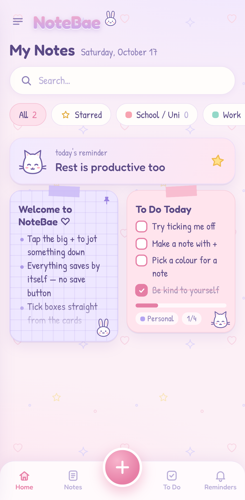
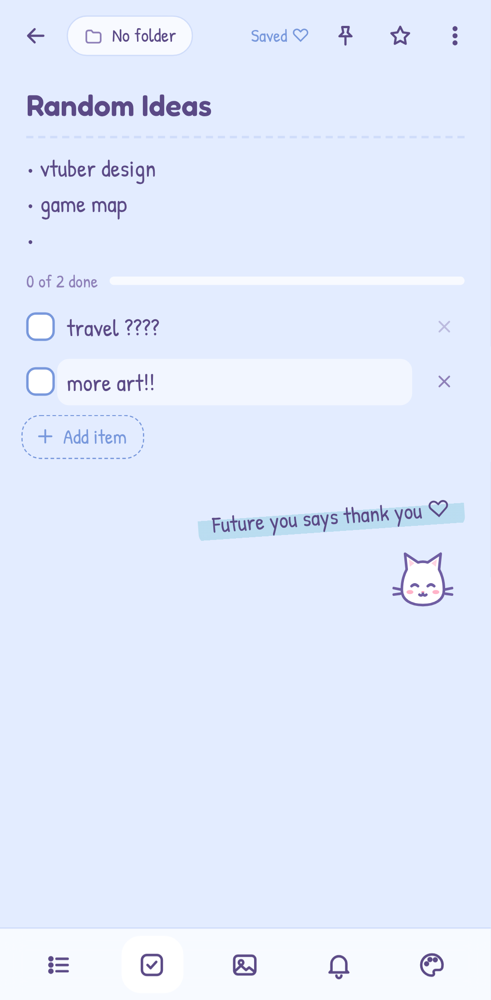
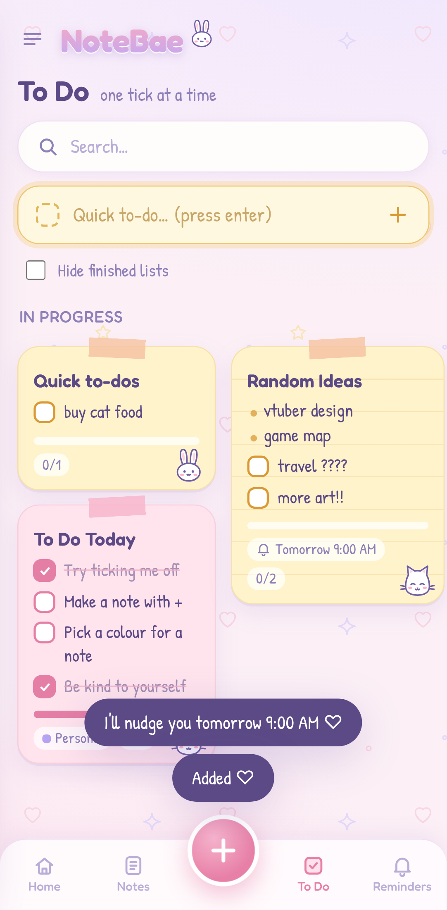

# NoteBae ♡

*Cute notes for brighter days.* A soft, pastel, low-friction note-taking app made for phones,
with bunny and cat doodles, washi-tape cards and handwritten fonts.

It's an installable web app (PWA). Once it's on your home screen it opens like any other app,
works offline, and keeps your notes privately on your phone.

<p>
  
  
  
</p>

## What's inside

- **Home** with colourful note cards: checklists, bullet notes and image notes. Pinned notes come first.
- **Tick boxes straight from the cards** without opening the note. You get a little heart burst for each one.
- **Sidebar** with Home, Notes, To Do, Reminders, Starred and Archive. On a phone there's also a bottom bar.
- **Colour-coded folders** (School / Uni, Work, Personal, Ideas, Gaming, Other) with note counts.
  You can add, rename, recolour and delete them.
- **Search** across titles, text, checklist items and folder names.
- **Editor** with checklists, photos (camera or gallery), pin, star, 7 pastel colours,
  plain/lined/grid paper and a bunny or kitty buddy.
- **Big + button** that opens a new note with the keyboard already up. In the To Do view it starts a checklist.
- **Quick to-do bar** in To Do: type, press enter, done.
- **Reminders** with one-tap presets: in 1 hour, tonight, tomorrow morning, Monday.
- **Encouraging messages** like "You got this!" and "Small steps still count".

### Built for an ADHD brain

- **No save button.** Everything autosaves as you type, and empty notes are quietly thrown away.
- **Fast capture.** Tap + and start typing. Long-press the app icon for *New note* / *New to-do list*,
  or share text or a link from any app straight into NoteBae.
- **Bullets continue themselves.** Start a line with `•` or `-` and press enter. An empty bullet ends the list.
- **Forgiving.** Deleting and archiving both have **Undo**, and archived notes are only resting.
- **Calm by default.** Short card previews, few buttons, no badges except overdue reminders.
  If your phone has *Remove animations* turned on, NoteBae turns off its animations too.
- **The Android back button does what you expect.** It closes the sheet, the note or the menu, in that order.

## Put it on your Android phone

1. Host it (see below). It needs an `https://` address.
2. Open that address in **Chrome** on your phone.
3. Tap **⋮ → Add to Home screen → Install**.
4. Open NoteBae from your home screen. Allow notifications the first time you set a reminder.

### Hosting on GitHub Pages (free)

This repo includes a workflow that publishes the app whenever `main` changes.

1. Merge this branch into `main`.
2. On GitHub, go to **Settings → Pages** and set **Source** to **GitHub Actions**.
3. After the *Deploy to GitHub Pages* action finishes, your app is at
   `https://<your-username>.github.io/<repo-name>/`.

GitHub Pages on a **private** repo needs a paid GitHub plan. Otherwise make the repo public
(your notes are never in the repo, only the app) or use another static host like Netlify or Cloudflare Pages.

## Good to know

- **Your notes live only on your phone**, in the browser's storage for this app. They aren't uploaded anywhere.
  Use **Menu → Backup & restore** now and then to save a backup file. The same file also moves
  your notes to a new phone or a computer.
- **Reminders** pop up while NoteBae is open or was recently in the background. Android doesn't let
  web apps schedule alarms while fully closed, so for must-not-miss things use your Clock or Calendar app too.
  Overdue reminders stay highlighted in the app until you mark them done.
- Photos are shrunk to about 1600px when you add them so storage doesn't fill up.

## Run it on a computer

No build step. Any static file server works:

```sh
npx http-server -p 8080 -c-1
# then open http://localhost:8080
```

Project layout:

```
index.html             app shell
css/app.css            all the styling (pastel tokens, cards, editor, sheets)
js/app.js              state, views, editor, folders, reminders, backup
js/ui.js               back-button-aware overlays, bottom sheets, toasts
js/db.js               IndexedDB storage
js/doodles.js          inline SVG doodles (bunny, cat, sleepy cat) and icons
sw.js                  offline cache and notification clicks
manifest.webmanifest   install info, launcher shortcuts, share target
```

When you change any file, bump `VERSION` in `sw.js` so installed copies pick up the update.
